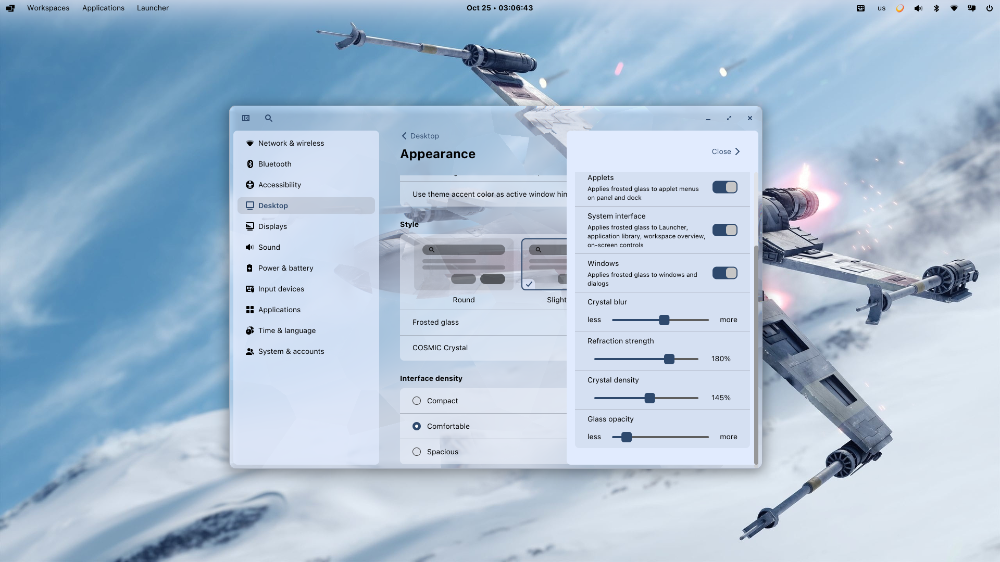

# COSMIC Crystal

A crystal glass effect for **COSMIC 1.10.0 and 1.11.0**, on **Arch Linux, Fedora, Ubuntu and Pop!_OS**.

Faceted light refraction, adjustable frost, thickness and density. **Everyday mode** keeps reading areas calm and concentrates the effect near window edges. Works wherever COSMIC enables Frosted Glass.



## Install

```sh
curl -fsSL https://raw.githubusercontent.com/motixo/cosmic-crystal/v0.8.0/install-online.sh | sh
```

Run as your desktop user, **without sudo**, then log out and back in. Open **Settings → Desktop → Appearance → COSMIC Crystal**.

Requires matching native `cosmic-comp` and `cosmic-settings` packages, `curl`, `tar`, and Python 3. Prebuilt downloads target x86_64, with glibc **2.44+ on Arch** or **2.42+ on Fedora**, or **2.39+ on Ubuntu/Pop!_OS (24.04+)**. The installer selects the matching archive, checks SHA-256, and saves previous launchers for removal. Keep `~/.local/bin` before `/usr/bin` in your login PATH.

## Build — Arch, Fedora, Ubuntu and Pop!_OS

```sh
git clone https://github.com/motixo/cosmic-crystal.git
cd cosmic-crystal
sudo sh scripts/dependencies.sh
./build-from-source.sh --jobs 4
```

The dependency script uses `pacman`, `dnf`, or `apt` for your distribution. Build and installation run as your normal user. Requires Rust 1.93+; sources are pinned to the installed COSMIC version.

On Ubuntu/Pop!_OS, install a newer Rust toolchain if `rustc --version` is below 1.93:

```sh
curl --proto '=https' --tlsv1.2 -sSf https://sh.rustup.rs | sh -s -- -y --profile minimal
. "$HOME/.cargo/env"
```

Build without installing:

```sh
./build-from-source.sh --build-only --jobs 4
./install.sh --build-dir ./build
```

Use `--cosmic-version 1.11.0 --build-only` to build another supported version. Complete source archives, including Rust dependencies and an offline build script, are in [Releases](https://github.com/motixo/cosmic-crystal/releases).

## Uninstall

```sh
curl -fsSL https://raw.githubusercontent.com/motixo/cosmic-crystal/v0.8.0/install-online.sh | sh -s -- --uninstall
```

Log out and back in. Previous launchers and unchanged preferences are restored.

GPL-3.0-only. Independent project; COSMIC is developed by System76 and its contributors.
